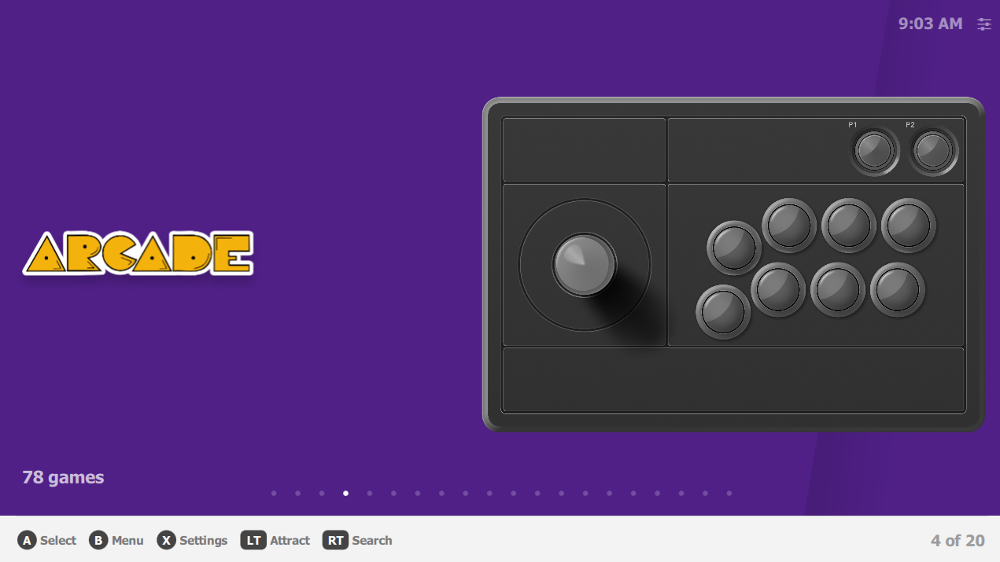
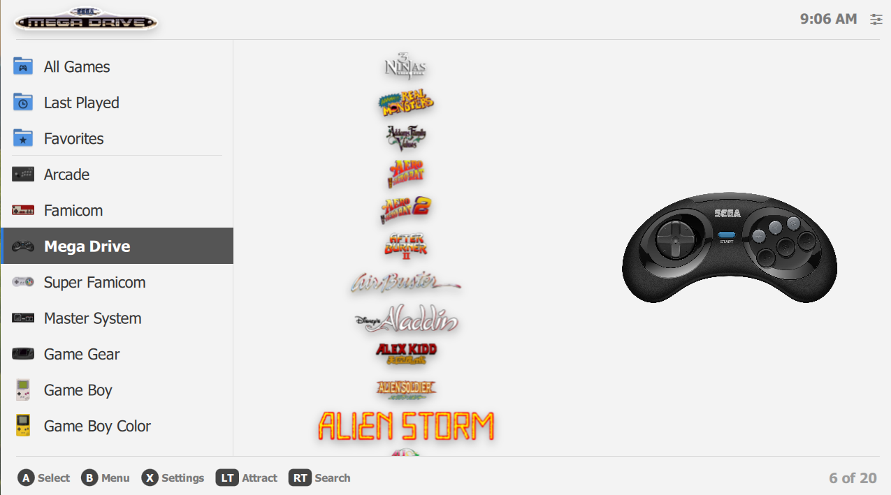
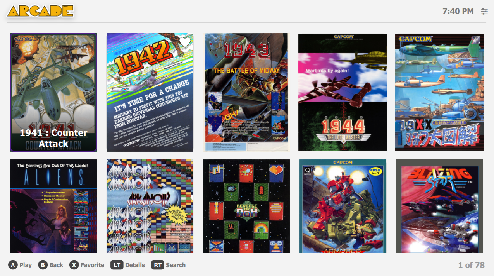
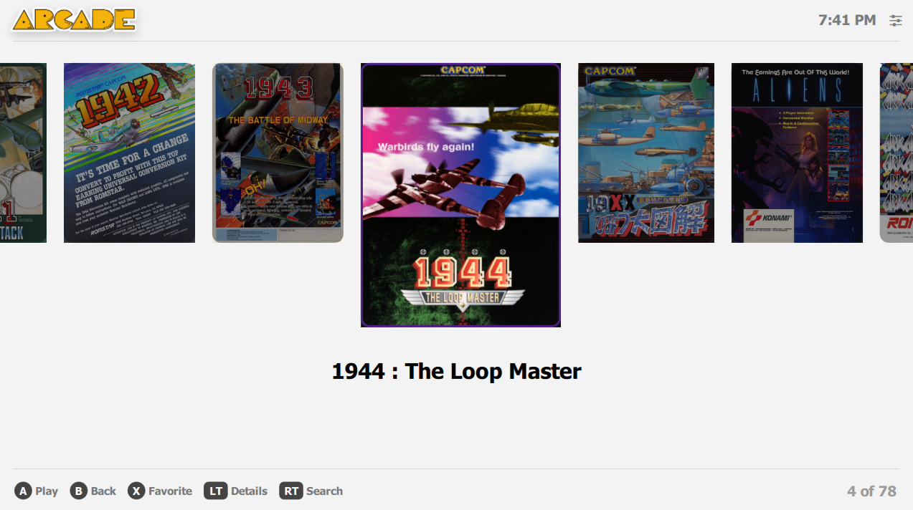
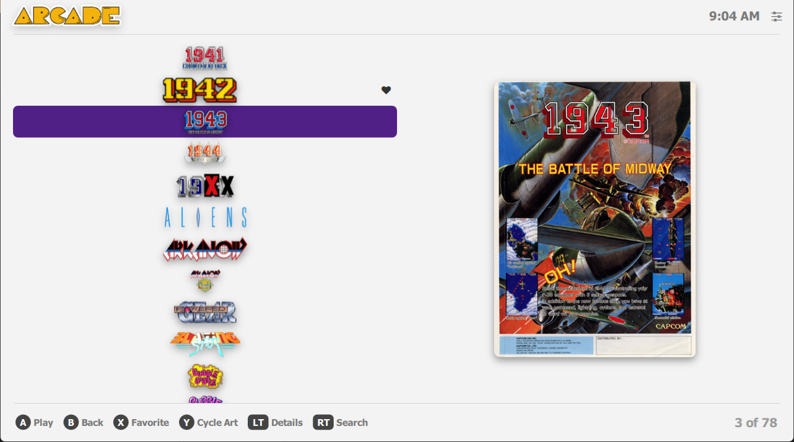
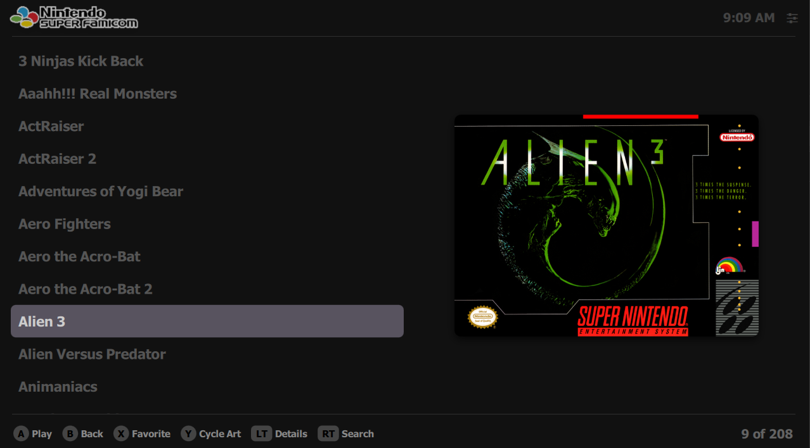
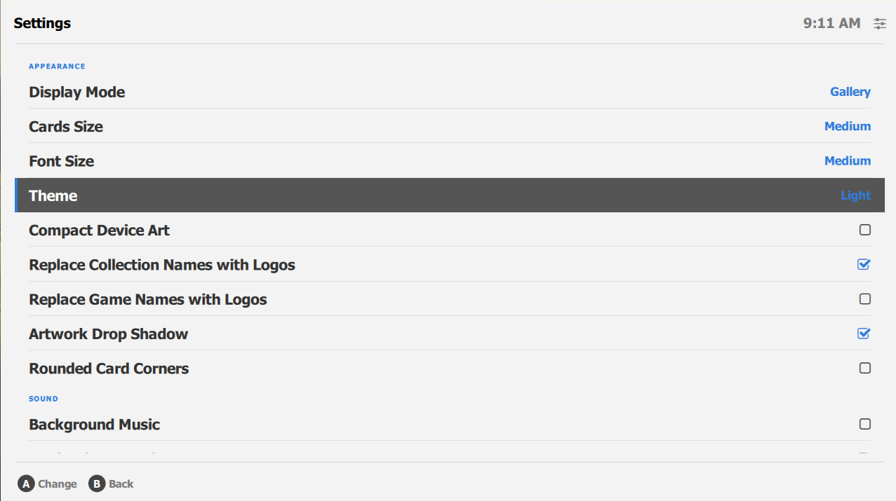

# Retro Mega Neo

A clean, fast [Pegasus](https://pegasus-frontend.org) theme for handhelds, desktops and TVs. It works with a
touchscreen, a mouse and keyboard, or a gamepad, and it has four ways to browse your library.

Retro Mega Neo is a fork of [plaidman's RetroMega Next](https://github.com/plaidman/retromega-next), which was
itself a from-scratch rewrite of [David Fumberger's RetroMega](https://github.com/djfumberger/retromega). This
fork adds new display modes, touch and mouse features, ten color themes, platform reordering and a lot of
performance and stability work. Everything that changed is in [CHANGELOG.md](CHANGELOG.md).

---

## At a glance

- **Four display modes**, switched on the fly in Settings: List, Sidebar, Grid and Gallery
- **Touch, mouse, keyboard and gamepad** all work everywhere - swipe, scroll, click, press and hold, or use the buttons
- **Ten themes** - Light, Dark, Black, Sapphire, Ruby, Emerald, Amethyst, Amber, Aquamarine and Diamond - plus an
  accent color of your choice
- **Made for small screens** - big touch targets on request, three font sizes, and options that trade looks for
  speed on slow devices
- **Nearly everything is configurable** from one Settings screen (only background music needs a file edit)

---

## Install

1. Download the latest release and extract it into your Pegasus
   [theme directory](http://pegasus-frontend.org/docs/user-guide/installing-themes), in a folder of its own. The
   folder name doesn't matter - Pegasus finds the theme through the `theme.cfg` inside it.
2. Pick **Retro Mega Neo** in Pegasus's settings menu.

### Artwork

The theme shows the box front, screenshot, wheel (logo) and video of each game when they are available. To get
them, scrape your library with one of these:

- the official Pegasus [guide](https://pegasus-frontend.org/docs/), or this
  [video guide](https://www.youtube.com/watch?v=fGWve7YYwGQ)
- [Skraper](https://www.skraper.net/), which makes scraping easier on a desktop

Games without artwork still work - they show their name.

---

## Browse your way

| Display mode | What you get |
|--------------|--------------|
| **List** | A collection carousel, then a single-column game list with a large art preview. The default. |
| **Sidebar** | A console sidebar built into the game list, instead of a separate collection screen. |
| **Grid** | A multi-column grid of box art, in three card sizes. |
| **Gallery** | A horizontal coverflow strip with the current game enlarged in the middle. |

Also available:

- **All Games, Last Played and Favorites** collections, each of which can be hidden, and favorites can be pinned to
  the top of every list
- **Search** games by name
- **Reorder your platforms** however you like, from Settings
- **Cycle a game's preview** through every scraped art type
- **Attract mode** - watch random game videos and launch straight from them
- **Game details** - description, metadata and full-size art
- **Background music** and navigation sounds

---

## Touch, mouse and gamepad

The theme is built to be used with whatever you have in your hands.

**Touch**
- **Swipe Paging** - a swipe moves one item at a time, like paging through photos; the Collection Screen follows
  your finger
- **Long-press a game** for a menu with Launch, Favorite and Details
- tap the page dots to jump to a collection; the header and footer buttons are tappable too, and **Larger Tap
  Targets** makes them bigger

**Mouse and keyboard**
- the wheel scrolls the game list and Settings without moving the selection, steps through collections on the
  Collection Screen, and moves one game at a time in Gallery; clicking a game selects it and clicking again launches it
- in Settings, the selection follows the mouse, and the arrows beside a choice step it back or forward
- right-click goes back, and the cursor turns into a hand over anything you can click

**Gamepad**
- full control with button legends for **Switch**, **Xbox** and **PlayStation** pads, matching the buttons you
  actually have

The full list of controls is in [CONTROLS.md](CONTROLS.md).

---

## Make it yours

| Setting | Choices |
|---------|---------|
| **Theme** | Light, Dark, Black (true black for OLED), and the colored Sapphire, Ruby, Emerald, Amethyst, Amber, Aquamarine and Diamond (silver) |
| **Accent Color** | Default, Blue, Green, Orange, Red, Purple, Pink or Yellow |
| **Font Size** and **Cards Size** | Three sizes each |
| **Overscan Margin** | 2% to 8% empty edge, for TVs that crop the picture |
| **Replace names with logos** | For both games and collections |
| **Artwork shadow** and **Rounded corners** | On or off |

Every setting is explained in [SETTINGS.md](SETTINGS.md).

---

## Running on a slow device

On a handheld or an older device, these help most:

- turn off **Artwork Drop Shadow** and **Rounded Card Corners**
- turn on **Delayed Images**
- keep video previews off (**Video on Game List**, **Video on Game Details**)
- use **List** or **Sidebar** rather than Grid or Gallery on very large libraries

The theme already loads artwork only at the size it is drawn, so even large scraped images cost little memory.

---

## Guides

| Guide | What is in it |
|-------|---------------|
| [CONTROLS.md](CONTROLS.md) | Every screen's controls for a pad, touch and mouse |
| [SETTINGS.md](SETTINGS.md) | Every setting: a table of choices and defaults at a glance, then each one explained in full |
| [CUSTOMIZATION.md](CUSTOMIZATION.md) | Adding music, trimming the details screen, editing colors and button labels |
| [DEVICES.md](DEVICES.md) | Adding a system, with its device art, icon and logo |
| [CHANGELOG.md](CHANGELOG.md) | What changed in each version |

---

## Credits
- Retro Mega Neo - new display modes, touch, mouse and color themes, and performance work:
    - [Hazem Abdelghani](https://github.com/hazem-abdelghani/retromega-neo)
- Retro Mega Next - the from-scratch rewrite that Retro Mega Neo is built on, with its features:
    - [plaidman](https://github.com/plaidman/retromega-next)
- Retro Mega - the original theme and design:
    - [DJFumberger](https://github.com/djfumberger/retromega)
- device images:
    - [pineapple.graphics](https://forums.launchbox-app.com/files/file/3889-photoreal-controller-vectors-by-pineapple-graphics/)
- collection images:
    - [Dan Patrick](https://forums.launchbox-app.com/files/file/3402-v2-platform-logos-professionally-redrawn-official-versions-new-bigbox-defaults/)

## License

---

## Screenshots

